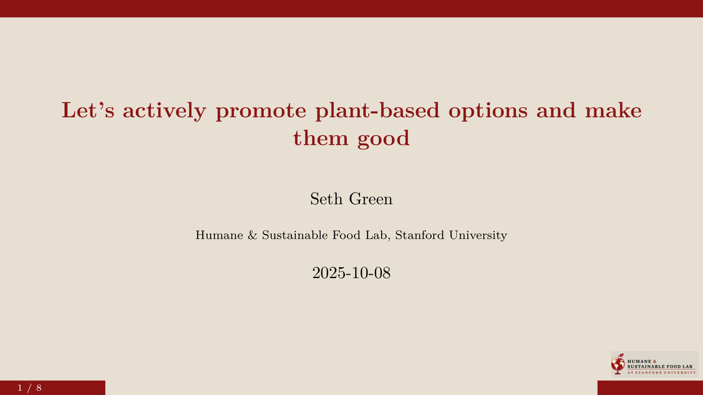

# Food Lab Slides

R Markdown template for creating Beamer presentations with [HSFL colors & logo](https://www.foodlabstanford.com/).

They look like this



There's also a sample presentation for the October 2025 Reducetarian summit.

## Installation

``` r
devtools::install_github("setgree/HSFL-slides")
```

## Reqs

-   R (\>= 4.0)
-   RStudio (recommended)
-   LaTeX distribution (TinyTeX, MacTeX, or MiKTeX)
    -   If you don't have LaTeX: `install.packages("tinytex"); tinytex::install_tinytex()`

## House style

- **Title slide**: affiliation is always "Humane & Sustainable Food Lab, Stanford University". The `date` field holds the event, month, and city.
- **Slides**: a title that states the point, text on the left, one big picture on the right. Keep text under ~30 words; put the rest in `::: notes` (not shown in the PDF).
- **Pictures**: one per slide, as large as the slide allows. Two side by side beats two stacked. Add `{.t}` to a picture slide's title (`## Title {.t}`) so content starts right under the title instead of floating in the middle.
- **Pacing**: about one slide per minute, counting the title slide.
- **Order**: past, present, future (what we found, what we're doing, what's next).
- **Footer and logo**: narrow red bars (15% of slide width, 2.5ex tall) with a 0.6cm logo, matching the October 2025 Reducetarian deck. If you change the logo size, change the footer bars with it, or the logo will float over a bar that doesn't fit it.
- **Before presenting**: check the PDF at full size, not as thumbnails.

## Customization

### Colors

The template uses:

- **Background**: Beige (#E8E1D3) 
- **Primary**: Stanford Cardinal (#8C1515) 
- **Text**: Dark Gray (#2E2D29)

To modify colors, edit `inst/rmarkdown/templates/foodlab_presentation/resources/beamerthemeFoodLab.sty`

### Aspect Ratio

Change from 16:9 to 4:3 in YAML:

``` yaml
classoption: "aspectratio=43"
```

## License

MIT License - free to use and modify for Food Lab presentations or whatever 😃 
