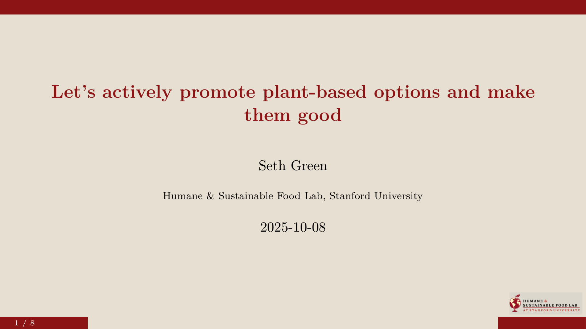

# Food Lab Slides

R Markdown template for creating Beamer presentations with [HSFL colors & logo](https://www.foodlabstanford.com/).

They look like this



There's also a sample presentation for the October 2025 Reducetarian summit.

## Installation

``` r
devtools::install_github("setgree/HSFL-slides")
```

## Usage

In RStudio: File > New File > R Markdown > From Template > Food Lab Presentation. Or:

``` r
rmarkdown::draft("my-talk.Rmd", template = "foodlab_presentation", package = "foodlabslides")
```

The YAML just needs

``` yaml
output: foodlabslides::foodlab_presentation
```

The theme, logo and preamble load from the package, so the deck folder only holds your Rmd and images. Options:

``` yaml
output:
  foodlabslides::foodlab_presentation:
    footer_url: "https://github.com/you/your-slides/"  # link in the middle of the footer
    show_title_slide: false                             # skip the title slide
```

It knits with lualatex (so emoji work), uses 16:9, and makes links blue; set `classoption`, `urlcolor` or `linkcolor` in the YAML to change those.

## Reqs

-   R (\>= 4.0)
-   RStudio (recommended)
-   LaTeX distribution (TinyTeX, MacTeX, or MiKTeX)
    -   If you don't have LaTeX: `install.packages("tinytex"); tinytex::install_tinytex()`

## Tips

- I like text on the left and one big picture on the right. Whatever you want to say but not show goes in `::: notes`.
- `## Title {.t}` pins a slide's content to the top instead of the middle.
- If you resize the logo (in `R/foodlab_presentation.R`), resize the footer bars in `beamerthemeFoodLab.sty` too, or it won't fit.
- Emoji work 🤷

## Customization

### Colors

The template uses:

- **Background**: Beige (#E8E1D3) 
- **Primary**: Stanford Cardinal (#8C1515) 
- **Text**: Dark Gray (#2E2D29)

To modify colors, edit `inst/rmarkdown/templates/foodlab_presentation/resources/beamerthemeFoodLab.sty`

### Aspect Ratio

Change from 16:9 to 4:3 in YAML:

``` yaml
classoption: "aspectratio=43"
```

## License

MIT License - free to use and modify for Food Lab presentations or whatever 😃 
